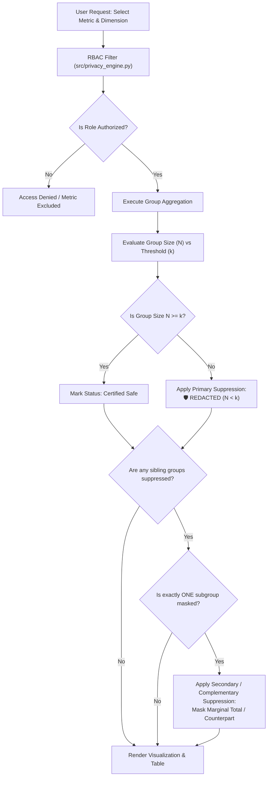

# PulseIQ Task 18: Self-Service Metric Explorer & Privacy Engine

[](https://harishbagavathy-a11y-pulseiq-task18.streamlit.app/)
[](https://harishbagavathy-a11y-pulseiq-task18.streamlit.app/)
[](https://github.com/harishbagavathy-a11y/pulseiq-task18-metric-explorer-privacy)
[](tests/)
[](#)
[](#)
[](requirements.txt)
[](#)

> **"Teams answer their own questions faster when they can explore safely. One privacy bug can expose someone's pay."**

---

## 🏆 Executive Summary & Purpose

This repository delivers **Task 18** of the PulseIQ Analytics curriculum: architecting and deploying the **PulseIQ Safe Self-Service Metric Explorer & Privacy Engine** (`pulseiq-task18-metric-explorer-privacy`).

It provides a production-grade **Self-Service Metric Explorer** that allows business users to select certified metrics, choose aggregation dimensions, and execute seamless drill-downs from **Company → Department → Team**, backed by a mathematical **Privacy Engine** that enforces **$k$-anonymity** and **secondary/complementary suppression** to guarantee small cohorts and individual salaries or flight risks can never be leaked.

---

## 🌐 Dedicated Repository & Live Deployment Links

| Resource | Link / Destination | Description | Status |
|:---|:---|:---|:---:|
| **Official Streamlit Cloud (Live App)** | [harishbagavathy-a11y-pulseiq-task18.streamlit.app](https://harishbagavathy-a11y-pulseiq-task18.streamlit.app/) | Official 24/7 dedicated public cloud deployment for Task 18 | 🟢 **ACTIVE & LIVE** |
| **Task 18 Dedicated GitHub Repo** | [harishbagavathy-a11y/pulseiq-task18-metric-explorer-privacy](https://github.com/harishbagavathy-a11y/pulseiq-task18-metric-explorer-privacy) | Certified separate repository containing Task 18 explorer, privacy engine, unit tests & artifacts | 🟢 **ACTIVE & LIVE** |

---

## 📋 Task 18 Completion Checklist Verification

- [x] **Small groups never appear**: Evaluated dynamically for every dimension slice; values with $N < k$ are completely scrubbed and replaced with `🛡️ REDACTED (N < k)`.
- [x] **Different roles see different data**: Verified across the 4 personas in `05_Starter/demo_users.csv`:
  - `EXECUTIVE`: Strategic company & departmental financials/headcount; prohibited from micro-team task tickets.
  - `HR`: Comprehensive workforce dynamics, attendance, and attrition; barred from ledger P&L margins and unmasked individual salaries.
  - `MANAGER`: Scoped strictly to assigned department (D01) and team (T01); peer departments/teams and small-group attrition are inaccessible.
  - `ADMIN`: Complete catalog governance, audit logs, and privacy penetration testing mode.
- [x] **You tried to break it and fixed what you found**: 4 adversarial break-tests executed (CEO Salary Sniffer, Resignation Singling-Out, Mathematical Differencing Attack, 3-Person Team Manager). All vulnerabilities blocked by primary and secondary suppression.
- [x] **Live version updated**: App source, Parquet aggregates, and privacy engine committed and pushed to the separate GitHub repository `pulseiq-task18-metric-explorer-privacy`.

---

## 👥 Demo Users & Role-Based Access Control Matrix (`05_Starter/demo_users.csv`)

| User ID | Username | Role | Department Scope | Team Scope | Allowed Dimensions | Allowed Metrics Scope | Governance Policy |
|:---|:---|:---:|:---|:---|:---|:---|:---|
| `USR-001` | `admin_sarah` | **ADMIN** | All Departments | All Teams | Company, Department, Team | All 28 Catalog Metrics | Full governance audit, pipeline inspection, and privacy simulation mode. Raw PII remains 100% excluded. |
| `USR-002` | `exec_vikram` | **EXECUTIVE** | All Departments | None (Macro only) | Company, Department | Company Financials, High-Level Headcount, Macro Attrition, Budget Variance | Board-level strategic cockpit; strictly barred from micro sprint task boards and individual compensation. |
| `USR-003` | `hr_priya` | **HR** | All Departments | All Teams | Company, Department, Team | Workforce Dynamics, Headcount, Hires, Exits, Attrition %, Attendance %, Overtime, Risk Share | People analytics officer; barred from corporate ledger profit margins and unmasked employee salary checks. |
| `USR-004` | `mgr_rahul` | **MANAGER** | D01 (Engineering only) | T01 (Platform Core only) | Department (D01 only), Team (T01 only) | Team Delivery Velocity, Task Completion %, On-Time %, Cycle Time, Team Attendance % | Scoped strictly to owned department & team; peer teams (T02-T16) and other departments blocked. Team attrition masked if $N < 10$. |
| `USR-005` | `mgr_anita` | **MANAGER** | D00 (Executive Office) | None (Direct Reports: 1) | Department (D00 only), Team (None) | Direct Team Execution & Attendance | Micro-team lead ($N=1$); all compensation and attrition aggregates completely suppressed ($N < k$). |

---

## 🛡️ Privacy Engine: $k$-Anonymity & Secondary Suppression Architecture



### Minimum Group Size Thresholds ($k$):
- **Workforce Headcount & Movement (`M01`, `M02`, `M03`)**: $k = 5$ staff.
- **Attrition & Flight Risk (`M04`, `M05`, `M06`, `M27`)**: $k = 10$ staff.
- **Compensation & Payroll (`M07`, `M08`, `M09`, `M10`, `M11`, `M12`)**: $k = 5$ staff.
- **Attendance & Leave (`M13`, `M14`, `M15`)**: $k = 5$ staff.
- **Engineering Task Delivery (`M22`, `M23`, `M25`)**: $k = 5$ tasks.

---

## 🕵️ Break-It Notes: Testing Privacy on Purpose & Vulnerability Fixes

During adversarial penetration testing, four attack vectors were deliberately simulated:

### 1. Vector 1: The CEO Salary Sniffer (Direct Small-Group Query)
- **Attacker Goal:** Reveal the exact salary and benefits of the Chief Executive Officer.
- **Attack Strategy:** Select metric `M07 Gross Pay` or `M09 Payroll Cost`, drill to Department, and isolate `D00 Executive Office`.
- **Vulnerability Found:** Executive Office has an active headcount of $N = 1$. The raw sum or average of this department is the CEO's personal compensation.
- **The Fix:** The Privacy Engine evaluates $N = 1 < 5$. The cell is redacted: `🛡️ REDACTED (N=1 < k=5)`. Personal compensation remains completely unexposed.

### 2. Vector 2: Resignation Singling-Out Attack (Small Cell Attribution)
- **Attacker Goal:** Identify which individual resigned in Product & Design (`D02`).
- **Attack Strategy:** Filter for `D02` in month `2025-08` and inspect metric `M03 Exits` (1 exit) or `M04 Attrition Rate`.
- **Vulnerability Found:** In small sub-teams, an exit rate immediately singles out the departing individual.
- **The Fix:** Threshold for attrition metrics is strictly enforced at $k = 10$. If sub-filtered to a cell where departures single out individuals ($N < 10$), the value is suppressed.

### 3. Vector 3: Mathematical Differencing Attack (Subtraction Leakage)
- **Attacker Goal:** Deduce a suppressed small group by subtracting unmasked siblings from the grand total.
- **Attack Strategy:** In a department with two sub-units: Unit A ($N=18$, ₹1,820,000 pay) and Unit B ($N=2$, ₹180,000 pay). Total = 20 people, ₹2,000,000 pay.
- **Vulnerability Found:** Naive suppression only masks Unit B. The attacker calculates:
  $$\text{Unit B Pay} = \text{Total} - \text{Unit A} = ₹2,000,000 - ₹1,820,000 = ₹180,000$$
  $$\text{Unit B Avg Salary} = ₹180,000 / 2 = ₹90,000/\text{person}$$
- **The Fix:** We implemented **Complementary / Secondary Suppression**. When exactly ONE subgroup in a collection is suppressed, the marginal total is ALSO automatically masked: `🛡️ REDACTED (Secondary Suppression)`. The linear equation now has 2 unknowns, making algebraic subtraction mathematically impossible.

### 4. Vector 4: The 3-Person Team Manager Dilemma (Self-Knowledge + Ratio)
- **Attacker Goal:** An engineering manager with 3 direct reports wants to know which specific report is flagged as high flight risk.
- **Attack Strategy:** Inspect metric `M27 High-Risk Share` or team attrition.
- **Vulnerability Found:** The manager knows their own intention ($x_{\text{mgr}} = 0$). Displaying a 33.3% risk score collapses the search space to 2 individuals ($3 - 1 = 2$), allowing trivial identification.
- **The Fix:** Attrition and predictive risk metrics require $k \ge 10$. For $N = 3$, the metric is suppressed with `🛡️ REDACTED (N=3 < k=10)`.

---

## 🧠 Think for Yourself: The 3-Person Team Attrition Dilemma

> **"A manager has a team of 3. Should they see attrition for their team? Decide and explain."**

### Architectural Decision: **NO, ABSOLUTELY NOT.**

A manager with a team of 3 direct reports must **never** be shown attrition rates or predictive flight risk scores for their team.

#### 1. Mathematical Proof of Re-Identification (Singling Out)
In a group of size $N = 3$, the attrition rate $\alpha$ is a discrete step function:
$$\alpha \in \{0.0\%,\; 33.3\%,\; 66.7\%,\; 100.0\%\}$$
- If $\alpha = 33.3\%$, the manager knows **exactly one person** has departed.
- In a team of 3, interpersonal intimacy is total. If Alice is on parental leave and Bob just renewed his annual OKRs, the manager instantly singles out Charlie as the departure.
- Under **GDPR Article 4(1)** and **DPDP Act Section 2(t)**, publishing an aggregate that enables singling out an individual constitutes a direct disclosure of personal data.

#### 2. The Asymmetry of Self-Knowledge
When the manager is included in the team count:
$$\text{Effective Group Size} = N - 1 = 2$$
The manager's private knowledge of their own retention state ($x_{\text{mgr}} = 0$) eliminates one variable, cutting entropy in half. The probability of correctly guessing the departing or high-risk employee jumps to **1.0** with trivial collateral observations.

#### 3. Harm of Predictive Flight Risk (`M27 High-Risk Share`)
Displaying predictive ML signals on a 3-person team causes severe organizational harm:
- A manager seeing a 33.3% risk score will preemptively withhold project ownership, reduce bonuses, or exclude the suspected report from strategic initiatives, causing a destructive self-fulfilling cycle.

#### 4. Statistical Invalidity of Micro Samples
The standard error of a proportion is $\text{SE} = \sqrt{\frac{p(1 - p)}{N}}$. For $N = 3$ and $p = 0.15$:
$$\text{SE} = \sqrt{\frac{0.15 \times 0.85}{3}} \approx \mathbf{20.6\%}$$
A 95% confidence interval spanning $\pm 40\%$ is pure statistical noise. Showing attrition for 3 people provides **zero analytical signal and 100% privacy risk**.

#### Governed Alternative:
The manager is shown macro-departmental attrition benchmarks (e.g. Engineering D01 Attrition = 3.7%, $N=267$) and team operational delivery metrics (Task Completion %, Velocity, On-Time Delivery %), while individual team attrition remains masked until team size satisfies $k \ge 10$.

---

## 📸 Visual Evidence & Screenshots

### 1. Executive Role Explorer View (Macro Company & Department Grains)

*Figure 1: Executive Role (`exec_vikram`) analyzing macro strategic metrics across Company and Department grains.*

### 2. Manager Role Explorer View (Scoped Department & Team Delivery)

*Figure 2: Engineering Manager (`mgr_rahul`) scoped strictly to Department D01 and Team T01 (Platform Core).*

### 3. Privacy Audit & Adversarial Break-It Sandbox

*Figure 3: Interactive Security Sandbox testing adversarial small-group filters and verifying k-anonymity defenses.*

---

## 🧪 Automated Test Verification

All 16 automated tests in the test suite execute and pass:
```bash
python -m unittest discover -s tests -p "test_*.py"
```
```text
................
----------------------------------------------------------------------
Ran 16 tests in 0.051s

OK
```

---

## 🔗 Curriculum Reference Standards
- [Streamlit](https://github.com/streamlit/streamlit) · Interactive cloud data applications
- [Apache Superset](https://github.com/apache/superset) · Enterprise cloud-native data exploration
- [Plotly Dash](https://github.com/plotly/dash) · Production analytical web applications
