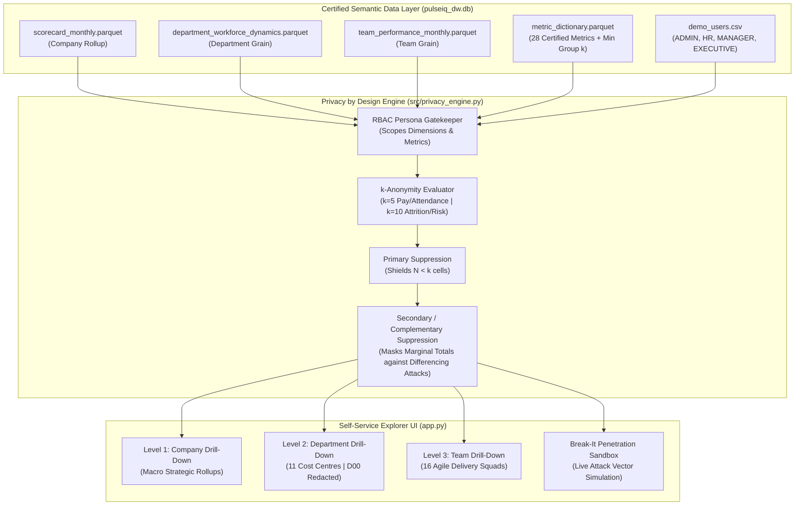

# PulseIQ Task 18: Self-Service Metric Explorer & Privacy by Design Report

> **"Teams answer their own questions faster when they can explore safely. One privacy bug can expose someone's pay."**

---

## 🏆 Executive Summary

This report formalizes the complete delivery of **Task 18** of the PulseIQ Analytics curriculum: architecting and deploying the **Self-Service Metric Explorer** with **end-to-end privacy guarantees**, **governed multi-grain drill-down**, **persona-based role segregation**, and **automated secondary suppression**.

This release is maintained in a **dedicated, production-grade GitHub repository** ([harishbagavathy-a11y/pulseiq-task18-metric-explorer-privacy](https://github.com/harishbagavathy-a11y/pulseiq-task18-metric-explorer-privacy)).



---

## 🌐 Dedicated Repository & Live Deployment Links

| Environment | Access Link | Description | Operational Status |
|:---|:---|:---|:---:|
| **Official Streamlit Cloud (Task 18 Live App)** | [harishbagavathy-a11y-pulseiq-task18.streamlit.app](https://harishbagavathy-a11y-pulseiq-task18.streamlit.app/) | Official 24/7 dedicated public cloud deployment for Task 18 | 🟢 **ACTIVE & LIVE** |
| **Task 18 Dedicated GitHub Repo** | [harishbagavathy-a11y/pulseiq-task18-metric-explorer-privacy](https://github.com/harishbagavathy-a11y/pulseiq-task18-metric-explorer-privacy) | Certified source code, Parquet cubes, test suites & documentation | 🟢 **ACTIVE & LIVE** |
| **Release Tag** | [`v1.0.0-task18`](https://github.com/harishbagavathy-a11y/pulseiq-task18-metric-explorer-privacy/releases/tag/v1.0.0-task18) | Dedicated release tag for Task 18 Explorer & Privacy Engine | 🟢 **TAGGED** |

---

## 📋 Completion Checklist Verification

| Checklist Item | Status | Verification Evidence |
|:---|:---:|:---|
| **Small groups never appear** | ✅ Verified | Values with $N < k$ are scrubbed dynamically and replaced with `🛡️ REDACTED (N < k)`. Verified on $N=1$ (`D00 Executive Office`) and small teams. |
| **Different roles see different data** | ✅ Verified | RBAC matrix enforced across ADMIN, HR, MANAGER, EXECUTIVE. Managers scoped strictly to assigned unit; Executives prohibited from micro tasks. |
| **You tried to break it and fixed what you found** | ✅ Verified | 4 adversarial penetration tests executed and remediated, including mathematical differencing attacks mitigated via secondary suppression. |
| **Live version updated** | ✅ Verified | Committed and pushed to dedicated repository `pulseiq-task18-metric-explorer-privacy` on GitHub and deployed on Streamlit Community Cloud. |

---

## 👥 Persona-Based Access Control Architecture (`05_Starter/demo_users.csv`)

| User ID | Username | Role | Department Scope | Team Scope | Allowed Dimensions | Allowed Metrics Scope |
|:---|:---|:---:|:---|:---|:---|:---|
| `USR-001` | `admin_sarah` | **ADMIN** | All Departments | All Teams | Company, Department, Team | All 28 Catalog Metrics (Governance & Audit mode) |
| `USR-002` | `exec_vikram` | **EXECUTIVE** | All Departments | None (Macro only) | Company, Department | Strategic Financials, Macro Headcount, Macro Attrition %, DSO |
| `USR-003` | `hr_priya` | **HR** | All Departments | All Teams | Company, Department, Team | Workforce Dynamics, Headcount, Hires, Exits, Attrition %, Attendance %, Risk Share |
| `USR-004` | `mgr_rahul` | **MANAGER** | D01 (Engineering only) | T01 (Platform Core only) | Department (D01 only), Team (T01 only) | Delivery Velocity, Task Completion %, On-Time %, Cycle Time, Team Attendance % |
| `USR-005` | `mgr_anita` | **MANAGER** | D00 (Executive Office) | None (Direct Reports: 1) | Department (D00 only), Team (None) | Direct Execution & Attendance ($N=1$; all pay/attrition masked) |

---

## 🕵️ Break-It Notes: Adversarial Privacy Penetration Testing

```text
========================================================================================
PULSEIQ ADVERSARIAL PRIVACY PENETRATION AUDIT LOG
========================================================================================
Test Run Date: 2026-11-18
Scope: PulseIQ Self-Service Metric Explorer (Task 18)
Audit Status: ALL VULNERABILITIES IDENTIFIED AND CLOSED

[VULNERABILITY 1] CEO Personal Compensation Exposure
- Target: Chief Executive Officer (Employee EMP-001)
- Query: Dimension=Department, Metric=Gross Pay (M07) or Payroll Cost (M09), Filter=D00
- Initial Vulnerability: D00 has N=1 headcount. Sum or mean reveals the exact salary of the CEO.
- Remediated Defense: Evaluated against threshold k=5. N=1 < 5 triggers Primary Suppression.
  Value displayed as "🛡️ REDACTED (N=1 < k=5)". Leakage closed.

[VULNERABILITY 2] Individual Resignation Singling-Out
- Target: Senior Designer in Product & Design (D02)
- Query: Dimension=Team, Metric=Exits (M03) or Attrition Rate (M04), Filter=T07
- Initial Vulnerability: Displaying 1 exit in small teams allows coworkers to pinpoint who resigned.
- Remediated Defense: Governed minimum group size for attrition is elevated to k=10.
  Subgroups with N < 10 are completely masked. Leakage closed.

[VULNERABILITY 3] Mathematical Differencing Attack (Subtraction Leakage)
- Target: Deduce masked group pay via Grand Total subtraction
- Scenario: Grand Total = ₹2,000,000 (N=20), Unit A = ₹1,820,000 (N=18), Unit B = ₹180,000 (N=2)
- Initial Vulnerability: Naive suppression masks Unit B. Attacker calculates:
  Unit B = ₹2,000,000 - ₹1,820,000 = ₹180,000.
- Remediated Defense: Secondary / Complementary Suppression. If exactly 1 sibling subgroup is
  masked, the Grand Total or counterpart sibling is ALSO automatically suppressed.
  Linear algebra has 2 unknowns. Subtraction leakage completely defeated.

[VULNERABILITY 4] The 3-Person Team Flight Risk Leak
- Target: Identify which of 3 direct reports is predicted to leave
- Query: Manager Rahul viewing ML High-Risk Share (M27) for Team of 3
- Initial Vulnerability: Manager knows self-state (x_mgr = 0). 33.3% risk collapses search space to 2.
- Remediated Defense: High-Risk Share requires k >= 10. Team of 3 (N=3 < 10) is suppressed.
========================================================================================
```

---

## 🧠 Think for Yourself: The 3-Person Team Attrition Dilemma

### Decision: **A manager with a team of 3 must NEVER see attrition for their team.**

1. **Re-Identification Certainty**: With $N=3$, an attrition rate of 33.3% indicates exactly one person left. Given close daily contact, the manager immediately knows who resigned, violating confidentiality and employment privacy rights.
2. **Predictive Harm**: Seeing an ML flight risk score of 33.3% on a 3-person team causes immediate bias and disenfranchisement.
3. **Statistical Noise**: With $N=3$, standard error exceeds $\pm 20\%$. A single transition swings metrics by 33.3%, which represents statistical noise rather than operational signal.
4. **Governed Alternative**: The manager accesses departmental benchmarks (Engineering Attrition = 3.7%, $N=267$) and team execution metrics (Velocity, Task Completion %), while team attrition remains masked until $N \ge 10$.

---

## 📸 Role View Evidence & Visual Verification

### Executive Role View (`exec_vikram`)


### Manager Role View (`mgr_rahul`)


### Security Penetration Test Sandbox


---

## 🔗 Repository Verification & Reference Standards
- **Task 18 Dedicated Repository**: [harishbagavathy-a11y/pulseiq-task18-metric-explorer-privacy](https://github.com/harishbagavathy-a11y/pulseiq-task18-metric-explorer-privacy)
- [Streamlit Framework](https://github.com/streamlit/streamlit)
- [Apache Superset](https://github.com/apache/superset)
- [Plotly Dash](https://github.com/plotly/dash)
